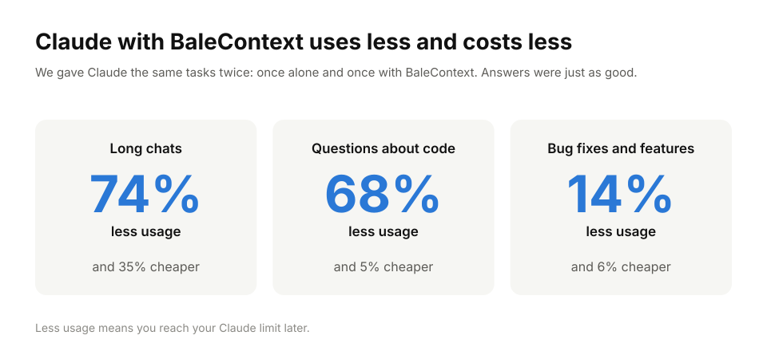

<p align="center">
  <picture>
    <source media="(prefers-color-scheme: dark)" srcset="docs/logo/banner-dark.svg">
    
  </picture>
</p>

<h1 align="center">Make your Claude limit last longer.</h1>

<p align="center">
  <strong>Don't lose your session to the limit.</strong>
  BaleContext finds the right code on your own computer and gives Claude just
  what it needs, with file and line, so it reads less.
</p>

[](docs/benchmarks.md)

<p align="center">
  Tested on real projects. <a href="docs/benchmarks.md#how-we-got-here">See all 18 tests, including the ones we lost.</a>
</p>

## Start in 3 commands

You need Python 3.11 or newer and Git. Run these inside your project:

```sh
python -m pip install "balecontext[code] @ git+https://github.com/stu1292200/balecontext"
balecontext index
balecontext install claude --hook
```

Then restart Claude Code in that project. That's it.

- **Free.** MIT licensed. No account, no API key, no subscription.
- **Runs on your computer.** BaleContext never uploads your code and has no telemetry.
- **Makes no AI calls of its own.** Indexing and search are plain local code.

If your terminal can't find `balecontext`, use `python -m balecontext` instead.

## What it does

Without help, a coding agent spends much of its limit **searching and
rereading** your files to find where things are.

BaleContext reads your project once and keeps a small local map of it. When you
ask Claude something, BaleContext hands over the matching code first, with the
file name and line numbers. Claude starts from the right place, so it opens fewer
files and makes fewer steps.

You keep working the same way. You just type your question.

## The results, wins and losses

Same model, same task, same project, run twice: once with plain Claude Code and
once with BaleContext. We count every token of the whole task.

| Kind of task | Fewer tokens | Lower cost |
|---|---|---|
| Long chat (8 questions about Django) | **74%** | **35%** |
| Questions about how code works | **68%** | **5%** |
| Bug fixes and new features | **14%** | **6%** |

- **Cost falls less than tokens.** Most of what plain Claude rereads is cached,
  and cached tokens are cheap. The usage limit still counts them.
- **We lost some tests too.** An earlier version made editing tasks cost up to
  41% more. Without the prompt hook, the tools alone saved nothing. Both results
  are on [the evidence page](docs/benchmarks.md), with every run.
- **These are early numbers.** Most tests ran once or twice. Claude Code with the
  `--hook` setup is the only setup measured so far.

## Status

**Alpha.** The core commands and the MCP server have automated tests. The
results above come from the current source on GitHub, which is what the 3
commands install. The older v0.1.0 download does not include the prompt hook.

## Other agents

BaleContext also connects to Codex, Gemini CLI and Cursor as a local MCP server.
We have **not measured savings** there yet. Run one installer in your project,
then restart that agent:

```sh
balecontext install codex --hook
balecontext install gemini
balecontext install cursor
```

These are **configuration adapters**, not claims of completed end-to-end tests
in every client. See [the compatibility matrix](docs/agents.md). For Codex,
`--hook` adds the same prompt hook as for Claude Code; its paired test is in
[docs/codex-test.md](docs/codex-test.md).

For other clients (including Antigravity, Hermes and Perplexity Computer), inspect
whether your installed version supports a local stdio MCP server. Print a generic
configuration with:

```sh
balecontext config generic
```

The server command is `python -m balecontext mcp --root /absolute/project/path`.
Hosted clients without access to local processes cannot use this local server
directly. No remote relay is included.

Once connected, try:

> Use BaleContext to find the session-token validation code and its callers.
> Cite source locations. Read additional source if the excerpts are incomplete.

## Privacy

Everything stays in a `.balecontext/` folder in your project. Secrets files,
`.env` files, private keys, build output and dependencies are skipped. This is
**not a complete secret detector**, so treat that folder as private.
[Full details below](#privacy-and-exclusions).

## Explore your project

```sh
balecontext query "Where are session tokens validated?" --budget 2000
balecontext export
```

Open `.balecontext/graph.html` to explore an interactive map of your code. It
works offline. The export also writes `graph.json` and `REPORT.md`. The viewer
shows up to 320 matching nodes at a time; the JSON has the full graph.

To try the included demo from this checkout:

```sh
balecontext index --root examples/shop
balecontext query "validate session token" --root examples/shop
balecontext related validate_token --direction callers --root examples/shop
balecontext path login validate_token --root examples/shop
balecontext export --root examples/shop
```

---

## Technical details

### How the prompt hook works

`balecontext install claude --hook` adds BaleContext to `.mcp.json`, adds a short
note to `CLAUDE.md`, and adds a Claude Code hook to `.claude/settings.json`. On
each prompt the hook looks up the matching code and hands it to Claude before it
starts. When a prompt asks to change code, it sends a short list of where things
are (file, line range, name) instead of the source. Use `--dry-run` to preview.

### What the installers change

Each installer edits project-scoped configuration, preserves other MCP servers,
backs up modified files, and adds a short instruction block. Use `--dry-run`
to preview. An existing BaleContext entry with different settings is left
untouched and reported for manual review. Project trust prompts remain the
client's responsibility.

The installer stores the absolute interpreter and project paths so the client
starts the right environment. These generated settings and backups are local
machine data: review before committing them. Re-run setup on another machine.

### Agent tools

Five tools are exposed: `balecontext_context`, `balecontext_expand`,
`balecontext_related`, `balecontext_read`, and `balecontext_status`. They do not
edit your source files or run shell commands. The local SQLite cache refreshes
before retrieval.

`balecontext_context` returns an evidence pack: a map of the matching
definitions, the entry point and the definitions it calls in call order (exact
source with line numbers), and a `COVERAGE: COMPLETE` or `PARTIAL` verdict. The
first response is capped at 4,000 estimated tokens. Missing pieces are fetched by
id with `balecontext_expand` instead of re-reading whole files.

### Automatic project updates

With the current source checkout, connecting an agent starts background indexing
automatically. While that connection stays open, the server checks for edits,
new files, renames, deletions and changed exclusions every two seconds. Changed
files are reparsed; stale source-linked notes are excluded from future retrieval.
No AI calls are needed for these updates. Each tool request also refreshes before
reading, so it does not depend on waiting for the next background scan.

Closing the agent connection stops monitoring. Reconnecting catches up with the
current project. Monitoring updates the local index; exported HTML/JSON files are
snapshots and require another `balecontext export` to update.

For a large project, set `--watch-interval 10` in the MCP server arguments to
reduce scanning frequency, or add `--no-watch` to keep only per-request refresh.
This implementation polls file contents; it is not yet a filesystem-event watcher
and large-repository performance has not been benchmarked.

### What you get

| Capability | Behavior |
|---|---|
| Incremental index | Content hashes skip unchanged files; removed or newly excluded files disappear from the index. |
| Automatic updates (unreleased) | Background refresh starts with the agent connection; retrieval also refreshes on demand. |
| Focused retrieval | Symbol-first ranking (exact identifiers and class qualifiers before body text, implementation code before tests and docs), then the entry point's call chain in call order. |
| Evidence | Every source result includes a path, symbol ID and line range. |
| Dependency graph | Python AST and optional JS/TS tree-sitter parsing; imports and conservative call resolution. |
| Cross-session notes | Explicitly saved notes reference file hashes; stale notes are excluded automatically. |
| Offline viewer | Search, filter, zoom, drag, and inspect graph nodes. No CDN assets. |
| Agent setup | Project-local CLI adapters and a small MCP stdio server. |

Python gets AST structural extraction. JavaScript, JSX, TypeScript and TSX get
tree-sitter structural extraction when the optional parsers are installed.
Markdown, JSON, YAML, SQL, Go, Rust, Java and other supported text formats are
searchable chunks; **they do not yet get structural code graphs**.

Imports resolved to local files are marked `EXTRACTED`. Static call-target
resolution is marked `INFERRED`; runtime dispatch can differ. External packages,
complex object receivers, re-exports, wildcard imports, tsconfig aliases, and
dynamic imports may be unresolved. The viewer's groups are connected components,
not semantic communities or an LLM's interpretation of architecture.

### Useful commands

```sh
balecontext doctor
balecontext status
balecontext read src/auth.py --start 10 --end 50
balecontext related validate_token --direction callers --depth 2
balecontext path login validate_token --undirected
balecontext remember "Sessions use the shared validator" --source src/auth.py
balecontext watch --interval 2
balecontext query "your task" --json
```

`--root` selects a project directory on every command. Source reads are limited
to 200 lines at a time. Ambiguous symbol names require a node ID returned by
search. If a query misses evidence, broaden it or use your agent's ordinary
search and source reads. Preserve that fallback to protect answer quality.

### Privacy and exclusions

The index lives in `.balecontext/`. Dependencies, build outputs, `.git`, `.env*`,
common credential filenames, private-key formats, binary files, linked files,
directory junctions, and files over 1 MB are excluded. Detected private keys and
common provider-token patterns cause the whole file to be skipped. **This is
not an exhaustive secret detector:** arbitrary passwords in ordinary source
files may still be indexed. Treat the local database and exported graph as
private project data.

When Git is available in a repository, `.gitignore` rules are applied using
Git's own matcher. Without Git or outside a repository, use `.balecontextignore`
for project exclusions. It supports positive path globs, one per line, with `#`
comments; negation is not supported there.

```text
private/**
customer-data/**
internal-notes.md
```

Retrieved source, documentation and saved notes are **untrusted evidence**,
not new instructions for an agent. Automatic indexing writes only the local
cache. Configuration changes happen only through an explicit `install` command.

### Token counting

BaleContext aims to reduce repeated reading and discovery while preserving
source evidence. `--budget` caps retrieved **text** using a UTF-8-bytes/4 heuristic.
It is not a model-specific token count, a hard provider-token cap, or an allowance
meter. MCP schemas, envelopes, instructions, reasoning, outputs and additional
tool calls also consume tokens.

Every paired Claude Code test run so far, including weak and negative results,
is on [the evidence page](docs/benchmarks.md). See [the benchmark protocol](benchmarks/README.md)
and the comparison script for provider-reported token totals, setup overhead,
retries and outcome checks. We will publish actual results rather than infer
total savings from a smaller context window.

The source comparison script flags each task that passed without BaleContext
but failed with it, even when another task improves. Optional elapsed-time
measurements include local setup time; missing measurements are reported as
unrecorded. See [the first evaluation plan](benchmarks/first-evaluation.md).

### Other ways to install

The v0.1.0 release (without the prompt hook):

```sh
python -m pip install "balecontext[code] @ https://github.com/stu1292200/balecontext/releases/download/v0.1.0/balecontext-0.1.0-py3-none-any.whl"
```

From a downloaded or cloned source checkout:

```sh
python -m pip install ".[code]"
```

The `code` extra adds JavaScript/TypeScript parsers. For Python and text-only
projects, `python -m pip install .` has **zero runtime dependencies**. The
package is not on PyPI yet, so a bare `pip install balecontext` does not work.

### Development

```sh
python -m pip install ".[code]"
python -m unittest discover -s tests -v
```

The suite tests incremental refresh, Python and optional TypeScript graphs,
source coverage, retrieval budgets, stale-note invalidation, exclusions,
path boundaries, HTML escaping, configuration preservation, and MCP over a real
subprocess. CI is configured for Windows and Linux with Python 3.11–3.14.

Read [CONTRIBUTING.md](CONTRIBUTING.md), [the architecture](docs/architecture.md),
and [the roadmap](ROADMAP.md). Contributions with reproducible quality or
efficiency improvements are especially welcome.

## License

[MIT](LICENSE) · Copyright 2026 Muhammad Baleegh. BaleContext is an original
implementation. Third-party dependencies retain their own licenses.
