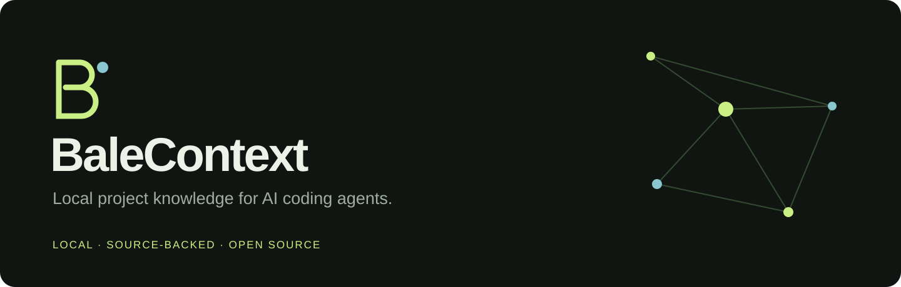

<p align="center">
  
</p>

<p align="center">
  <strong>Give your coding agent the right source, without rediscovering your project every session.</strong><br>
  Local indexing · Source-backed retrieval · Dependency graphs · MCP · MIT
</p>

# BaleContext

BaleContext builds a reusable map of your code and text documents, then gives
coding agents focused source excerpts and relationships. Everything runs on
your computer. No LLM is used for indexing or retrieval. No API key, cloud
account, subscription, embedding download, or telemetry is required.

Created by **Muhammad Baleegh**. This is an original implementation, inspired by
the general idea of graph-assisted code navigation. It is not affiliated with Graphify.

**Status: v0.1.0 alpha.** Core CLI and MCP protocol tests are automated. Live
integration tests in individual agent applications and real-world agent token
benchmarks are still pending. The 90–95% total-token reduction is a research
target, not a measured result or guarantee.

## Install

Requires Python 3.11 or newer. Install the alpha release with JavaScript/TypeScript support:

```sh
python -m pip install "balecontext[code] @ https://github.com/stu1292200/balecontext/releases/download/v0.1.0/balecontext-0.1.0-py3-none-any.whl"
```

Or, from a downloaded or cloned source checkout:

```sh
python -m pip install ".[code]"
```

The `code` extra adds JavaScript/TypeScript parsers. For Python and text-only
projects, `python -m pip install .` has **zero runtime dependencies**.
If your terminal cannot find `balecontext`, use `python -m balecontext` instead.
The package has not yet been published to PyPI; a bare `pip install balecontext`
is not an installation path for this release.

## First project

Run these commands in the project you want your agent to understand:

```sh
balecontext index
balecontext query "Where are session tokens validated?" --budget 2000
balecontext export
```

Open `.balecontext/graph.html` to explore the interactive graph. The export is
fully self-contained and works offline. It also produces `graph.json` and
`REPORT.md`. The viewer shows up to 320 matching nodes at a time for responsiveness;
the JSON export contains the full indexed graph.

To try the included demo from this checkout:

```sh
balecontext index --root examples/shop
balecontext query "validate session token" --root examples/shop
balecontext related validate_token --direction callers --root examples/shop
balecontext path login validate_token --root examples/shop
balecontext export --root examples/shop
```

## Connect your agent

Run **one** installer in your application project, then restart that agent:

```sh
balecontext install claude
balecontext install codex
balecontext install gemini
balecontext install cursor
```

Each installer edits project-scoped configuration, preserves other MCP servers,
backs up modified files, and adds a short instruction block. Use `--dry-run`
to preview. An existing BaleContext entry with different settings is left
untouched and reported for manual review. Project trust prompts remain the
client's responsibility.

The installer stores the absolute interpreter and project paths so the client
starts the right environment. These generated settings and backups are local
machine data: review before committing them. Re-run setup on another machine.

These are **configuration adapters**, not claims of completed end-to-end tests
in every client. See [the compatibility matrix](docs/agents.md).

For other clients (including Antigravity, Hermes and Perplexity Computer), inspect
whether your installed version supports a local stdio MCP server. Print a generic
configuration with:

```sh
balecontext config generic
```

The server command is `python -m balecontext mcp --root /absolute/project/path`.
Hosted clients without access to local processes cannot use this local server
directly. No remote relay is included.

Once connected, try:

> Use BaleContext to find the session-token validation code and its callers.
> Cite source locations. Read additional source if the excerpts are incomplete.

Five tools are exposed: `balecontext_context`, `balecontext_expand`,
`balecontext_related`, `balecontext_read`, and `balecontext_status`. They do not
edit your source files or run shell commands. The local SQLite cache refreshes
before retrieval.

`balecontext_context` returns an evidence pack: a map of the matching
definitions, the entry point and the definitions it calls in call order (exact
source with line numbers), and a `COVERAGE: COMPLETE` or `PARTIAL` verdict. The
first response is capped at 4,000 estimated tokens. Missing pieces are fetched by
id with `balecontext_expand` instead of re-reading whole files.

## What you get

| Capability | Behavior |
|---|---|
| Incremental index | Content hashes skip unchanged files; removed or newly excluded files disappear from the index. |
| Focused retrieval | Symbol-first ranking (exact identifiers and class qualifiers before body text, implementation code before tests and docs), then the entry point's call chain in call order. |
| Evidence | Every source result includes a path, symbol ID and line range. |
| Dependency graph | Python AST and optional JS/TS tree-sitter parsing; imports and conservative call resolution. |
| Cross-session notes | Explicitly saved notes reference file hashes; stale notes are excluded automatically. |
| Offline viewer | Search, filter, zoom, drag, and inspect graph nodes. No CDN assets. |
| Agent setup | Project-local CLI adapters and a small MCP stdio server. |

Python gets AST structural extraction. JavaScript, JSX, TypeScript and TSX get
tree-sitter structural extraction when the optional parsers are installed.
Markdown, JSON, YAML, SQL, Go, Rust, Java and other supported text formats are
searchable chunks; **they do not yet get structural code graphs**.

Imports resolved to local files are marked `EXTRACTED`. Static call-target
resolution is marked `INFERRED`; runtime dispatch can differ. External packages,
complex object receivers, re-exports, wildcard imports, tsconfig aliases, and
dynamic imports may be unresolved. The viewer's groups are connected components,
not semantic communities or an LLM's interpretation of architecture.

## Useful commands

```sh
balecontext doctor
balecontext status
balecontext read src/auth.py --start 10 --end 50
balecontext related validate_token --direction callers --depth 2
balecontext path login validate_token --undirected
balecontext remember "Sessions use the shared validator" --source src/auth.py
balecontext watch --interval 2
balecontext query "your task" --json
```

`--root` selects a project directory on every command. Source reads are limited
to 200 lines at a time. Ambiguous symbol names require a node ID returned by
search. If a query misses evidence, broaden it or use your agent's ordinary
search and source reads. Preserve that fallback to protect answer quality.

## Privacy and exclusions

The index lives in `.balecontext/`. Dependencies, build outputs, `.git`, `.env*`,
common credential filenames, private-key formats, binary files, linked files,
directory junctions, and files over 1 MB are excluded. Detected private keys and
common provider-token patterns cause the whole file to be skipped. **This is
not an exhaustive secret detector:** arbitrary passwords in ordinary source
files may still be indexed. Treat the local database and exported graph as
private project data.

When Git is available in a repository, `.gitignore` rules are applied using
Git's own matcher. Without Git or outside a repository, use `.balecontextignore`
for project exclusions. It supports positive path globs, one per line, with `#`
comments; negation is not supported there.

```text
private/**
customer-data/**
internal-notes.md
```

Retrieved source, documentation and saved notes are **untrusted evidence**,
not new instructions for an agent. Automatic indexing writes only the local
cache. Configuration changes happen only through an explicit `install` command.

## Token savings and quality

BaleContext aims to reduce repeated reading and discovery while preserving
source evidence. `--budget` caps retrieved **text** using a UTF-8-bytes/4 heuristic.
It is not a model-specific token count, a hard provider-token cap, or an allowance
meter. MCP schemas, envelopes, instructions, reasoning, outputs and additional
tool calls also consume tokens.

There is no measured end-to-end savings claim yet. See [the benchmark protocol](benchmarks/README.md)
and the comparison script for provider-reported token totals, setup overhead,
retries and outcome checks. We will publish actual results rather than infer
total savings from a smaller context window.

## Development

```sh
python -m pip install ".[code]"
python -m unittest discover -s tests -v
```

The suite tests incremental refresh, Python and optional TypeScript graphs,
source coverage, retrieval budgets, stale-note invalidation, exclusions,
path boundaries, HTML escaping, configuration preservation, and MCP over a real
subprocess. CI is configured for Windows and Linux with Python 3.11–3.14.

Read [CONTRIBUTING.md](CONTRIBUTING.md), [the architecture](docs/architecture.md),
and [the roadmap](ROADMAP.md). Contributions with reproducible quality or
efficiency improvements are especially welcome.

## License

[MIT](LICENSE) · Copyright 2026 Muhammad Baleegh.
Third-party dependencies retain their own licenses. No Graphify code,
documentation, branding, or assets are bundled in this project.
