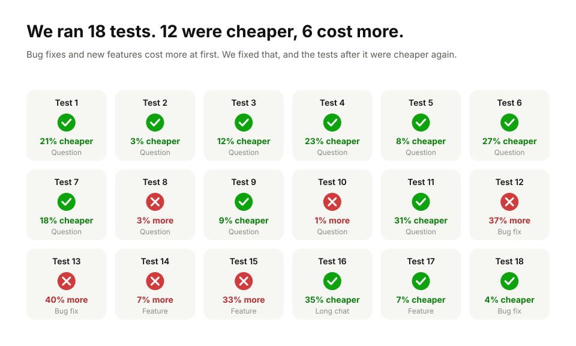

# Token savings: the evidence

This page shows every paid agent test we have run on BaleContext so far,
including the weak and negative ones, how each test works, and how to repeat
it yourself. It is updated as new runs come in.

**Last updated:** 13 October 2026.

## The short version

All numbers are whole-task totals on Claude Code with `sonnet`, BaleContext's
prompt hook against plain Claude Code, same question and project. The answers
were checked against the source and were equal in quality unless a row says
otherwise.

| Kind of task | Fewer tokens | Lower cost | Runs |
|---|---|---|---|
| Single questions and short conversations about how code works | 65–69% | about even (−1% to 9%) | 2 per test |
| Long conversation (8 questions about Django) | **74%** | **35%** | 1 |
| Editing tasks (fix a bug, add a feature), with the small pointer pack | 12–16% | 5–7% | 1 per task |
| Editing tasks with the full evidence pack (first attempt) | **−50% to +15%** | **−41% to −7%** (more expensive) | 1 per task |

1. **What we count:** the total tokens Claude Code reports for the whole task,
   every model call included. We never compare one search answer with the size
   of the whole project.
2. **Why cost falls less than tokens:** most of plain Claude's extra tokens
   are cached re-reads of the conversation, which are cheap. The answer itself
   costs about the same with or without BaleContext.
3. **Negative results are included:** the first version used 50% more tokens,
   the tools without the prompt hook saved nothing, and the full evidence pack
   made editing tasks more expensive. All are in the tables below.

## How we got here

Every paid test, in the order it was run, with the cost saved or lost against
plain Claude Code on the same task.



## Why "times smaller context" numbers are not used here

A retrieval tool can easily report that its answer is 50 or 70 times smaller
than the whole project. That number is true and says almost nothing about
savings, because no agent reads a whole project. What a user pays for is
every model call in the task: the agent's own instructions, the conversation
so far, the evidence, any further searching, and the answer. If the evidence
is wrong or incomplete, the agent searches anyway and the task gets more
expensive, not less. So this page only reports whole-task totals.

## How each test works

The script is [`benchmarks/claude_pair.py`](../benchmarks/claude_pair.py).
Step-by-step instructions are in [claude-code-test.md](claude-code-test.md).

1. **Same everything except BaleContext.** Both sides ("arms") run Claude Code
   on the same checkout of an open-source project at a pinned commit, with the
   same model (`sonnet`), the same read-only tools (Read, Grep, Glob; no edits,
   no shell) and no other MCP servers.
   - `without`: plain Claude Code.
   - `hook`: the same, plus BaleContext's prompt hook, which adds cited source
     evidence to the user's message before Claude's first step. Claude Code's
     own instructions and tool list stay identical, so its prompt caching is
     comparable.
2. **Whole-task totals.** Tokens and cost come from Claude Code's own JSON
   result for the task, every model call included. Cached input still counts
   as tokens; we never subtract it.
3. **Order and caching.** The two arms alternate which goes first, and since
   the "fair rerun" of 11 October each run's prompt ends with a different
   number so no run can reuse another's cached conversation. Earlier runs that
   reused the cache are marked as flattered in the table.
4. **Conversations.** Multi-question tests send the follow-ups in the same
   Claude Code session, one after another, as a person would type them. The
   script reports the conversation total and each question's own tokens.
5. **Medians.** Most tests ran 2 or 3 times per arm; the table shows medians.
6. **Quality.** The answers are saved side by side. A saving only counts if
   the BaleContext answer is as correct and complete as the plain one. We
   checked cited file and line numbers against the source for the answers
   noted below. This review was done by us, not blind and not by an
   independent reviewer.

Question tests change nothing in the project checkout; editing tasks are
undone after every run. Local indexing uses no model
tokens; the hook's running time (about 1 to 5 seconds) is reported
separately in the project record.

## All paid runs so far (explanation questions)

"Saving" is `1 − hook ÷ without`. A negative saving means BaleContext used
more. Commits refer to the BaleContext version tested (on the development
branch of [pull request #1](https://github.com/stu1292200/balecontext/pull/1),
now merged into `main`).

### Single questions

| Date | Version | Project, question | Runs | Without (median tokens) | BaleContext | Token saving | Cost saving | Notes |
|---|---|---|---|---|---|---|---|---|
| 11 Oct | 5276d15 (first alpha) | Django, `form.is_valid()` (Codex agent, not Claude Code) | 1 | 141,231 | 212,141 | **−50.2%** | n/a | The search answer was 55k characters and did not contain the code that answers the question, so the agent searched anyway. Led to the ranking rewrite. |
| 11 Oct | early PR #1 | Django, `form.is_valid()`, MCP tools only | 1 | not recorded | not recorded | **−1.5%** | **−6.3%** | Tools alone did not help: 7 steps against 6. |
| 11 Oct | b0bc7e7 | same, prompt hook | 1 | 90,251 | 24,557 | 72.8% | −8.8% | Hook answer missed `fields.py` and `ModelForm._post_clean`; fixed next. |
| 11 Oct | e7c7f6d | same | 3 | 88,262 | 47,205 | 46.5% | 52.1%\* | Hook needed 2 extra reads. |
| 11 Oct | 1a2bcf1 | same | 3 | 111,708 | 24,179 | 78.4% | 62.9%\* | One step, no tools every run. |
| 11 Oct | ad26ce6 | Express `a419aa7`, `res.json()` | 3 | 83,141 | 22,992 | 72.3% | 67.5%\* | Hook answer's line numbers checked, all correct. |
| 11 Oct | ad26ce6 | requests `611c616`, `Session.request()` trace | 3 | 127,453 | 76,684 | 39.8% | 49.1%\* | Evidence was incomplete, so Claude read more. |
| 11 Oct | b484e3d | same | 3 | 130,075 | 89,583 | 31.1% | 56.5%\* | |
| 11 Oct | 67329d5 | same | 3 | 125,015 | 63,015 | 49.6% | 63.0%\* | |
| 11 Oct | 28b940d | same, **fair rerun** (no cache reuse) | 3 | 98,603 | 63,040 | 36.1% | **−17.5%** | On a new question the hook cost more: its evidence file was larger than what plain Claude read. |
| 11 Oct | 28b940d | Django `0f34a4c`, `form.is_valid()`, fair rerun | 3 | 90,059 | 24,221 | 73.1% | 27.6% | |
| 11 Oct | 1ef3575 | requests trace, smaller evidence file | 3 | 121,696 | 56,494 | 53.6% | 2.6% | About 40 cited line ranges checked, none wrong. |

\* Flattered: these runs used identical prompts, so later runs reused cached
text. The fair reruns from 28b940d onward fixed this.

### Conversations (several questions in one session)

| Date | Version | Project, conversation | Runs | Without (median tokens) | BaleContext | Token saving | Cost saving | Notes |
|---|---|---|---|---|---|---|---|---|
| 12 Oct | 9890a96 | requests, trace + redirects follow-up | 3 | 207,223 | 139,213 | 32.8% | about 0% | Follow-up alone: hook about 10% **more expensive**. |
| 12 Oct | eda7beb | same | 3 | 210,421 | 97,466 | 53.7% | 10.5% | Follow-up alone 63.2% fewer tokens, 26.6% cheaper. |
| 12 Oct | c09c8d1 | requests, 4 questions | 3 | 550,341 | 281,326 | 48.9% | 21.4% | All four hook answers spot-checked, correct. |
| 12 Oct | c09c8d1 | Django, 4 questions | 3 | 404,054 | 290,224 | 28.2% | 1.0% | Evidence missed code for 2 follow-ups, so Claude searched. |
| 12 Oct | 6542285 | Django, 4 questions | 2 | 354,223 | 208,430 | 41.2% | 3.4% | All answers checked, correct. |
| 12 Oct | 962455c | Django, 4 questions, one session | 2 | 341,571 | 116,798 | 65.8% | 12.5% | Every hook question took one step, no tools. |
| 12 Oct | 962455c | requests, 4 questions, one session | 2 | 499,381 | 232,518 | 53.4% | 22.9% | |
| 12 Oct | 716c5a9 | requests, 4 questions | 2 | 552,230 | 197,816 | 64.2% | 20.8% | 0 wrong claims in about 131 hook claims; plain arm made 2 behaviour errors. |
| 12 Oct | 716c5a9 | Django, 3 hard multi-file questions | 2 | 489,579 | 257,080 | 47.5% | 13.5% | 0 wrong citations in about 205 hook claims; 2 answers slightly less complete. |
| 12 Oct | 9b1da7b | requests, 4 questions | 2 | 449,222 | 166,175 | 63.0% | 7.9% | One question re-wrote Claude Code's cache in one run ($0.125 against $0.044). |
| 12 Oct | 9b1da7b | Django, 3 hard questions | 2 | 694,121 | 142,734 | **79.4%** | **27.4%** | Best result so far. Hook slightly behind on question 1 (2 errors, both in code it said it had not seen). |
| 12 Oct | 8a5c61a | Django, 3 hard questions | 2 | 543,861 | 178,067 | 67.3% | 17.6% | Answer citations checked, all correct so far. |
| 12 Oct | 8a5c61a | Django, 3 "who calls / what breaks" questions | 2 | 228,078 | 86,726 | 62.0% | **−2.9%** | Fewer tokens but slightly more cost: Claude Code re-sent the first question's evidence as new text on the second question (see Limits). |
| 12 Oct | 93b4002 | Django, 3 hard questions | 2 | 483,642 | 148,038 | 69.4% | 9.3% | Every hook question one model call. Questions 1 and 2 more complete than plain Claude, question 3 equal. |
| 12 Oct | 1d33647 | Django, 3 "who calls" questions | 2 | 256,416 | 89,515 | 65.1% | **−1.4%** | The cache re-send happened again and cost $0.054 of $0.196. All citations right; question 2 thinner than plain Claude on what would break. |
| 12 Oct | 1d33647 | same, with every request logged | 1 | 396,366 | 133,437 | 66.3% | 30.9% | Logged to find the cache re-send (see Limits). |

### Raw results

The full results of the conversation tests from 12 October and the bigger
tasks from 13 October, with every model call, every tool call, both arms'
complete answers and, for editing tasks, both arms' code changes, are in
[`benchmarks/results/`](../benchmarks/results/). Local folder paths were
replaced with `<checkout>`; nothing else was changed. Earlier runs were kept
only as console summaries, so only their numbers are shown here.

### Per question, latest runs (median tokens)

Django, three hard multi-file questions (9b1da7b):

| Question | Without | BaleContext | Saving |
|---|---|---|---|
| Trace a request from `WSGIHandler.__call__` through middleware and URL resolution | 225,998 | 34,066 | 84.9% |
| How `migrate` runs, from `execute_from_command_line` to `handle()` | 205,006 | 50,595 | 75.3% |
| How `` and `` render | 263,116 | 58,073 | 77.9% |

requests, four questions in one session (9b1da7b):

| Question | Without | BaleContext | Saving |
|---|---|---|---|
| Trace `Session.request()` | 114,334 | 34,734 | 69.6% |
| Redirects, and when the body is read | 70,742 | 39,709 | 43.9% |
| How cookies are saved and re-sent | 122,340 | 43,573 | 64.4% |
| How the proxy is chosen, including `no_proxy` | 141,806 | 48,158 | 66.0% |

Where the tokens go (8a5c61a, Django hard questions, whole conversation):

| Run | Arm | Total | Input | Cache write | Cache read | Output | Steps | Tool calls | Cost (USD) |
|---|---|---|---|---|---|---|---|---|---|
| 1 | without | 450,244 | 24 | 45,304 | 395,088 | 9,828 | 24 | 21 | 0.319 |
| 1 | hook | 209,306 | 12 | 44,630 | 156,072 | 8,592 | 11 | 8 | 0.280 |
| 2 | hook | 146,828 | 6 | 47,064 | 91,243 | 8,515 | 3 | 0 | 0.283 |
| 2 | without | 637,478 | 34 | 45,479 | 579,604 | 12,361 | 43 | 40 | 0.364 |

This table explains the gap between tokens and cost. Plain Claude's extra
tokens are almost all cache reads (re-sending the growing conversation on each
step), which are priced at about a tenth of normal input. Cache writes and the
answer itself cost about the same in both arms.

## Bigger tasks

Run on 13 October, one run each (sonnet, version d543f80 unless noted). The
editing tasks let Claude edit files (no shell). A planted bug is put back
before each run, and the checkout is reset after it. Task files and notes on
what a correct result looks like are in [`benchmarks/tasks/`](../benchmarks/tasks/).

| Version | Project, task | Without (tokens) | BaleContext | Token saving | Cost saving | Notes |
|---|---|---|---|---|---|---|
| d543f80 | Django, 8-question conversation (read only) | 2,077,821 (78 steps, $0.817) | 536,507 (8 steps, $0.530) | **74.2%** | **35.2%** | One model call per question with BaleContext. |
| d543f80 | Django, fix a planted middleware-order bug | 121,533 | 153,149 | **−26.0%** | **−37.2%** | Full evidence pack. Both sides fixed the bug correctly. |
| d543f80 | requests, fix a planted `merge_setting` bug | 98,091 | 147,675 | **−50.5%** | **−40.5%** | Full evidence pack. Both fixed it correctly. |
| d543f80 | Django, add an option to `listurls` | 190,644 | 161,571 | 15.2% | **−7.4%** | Full evidence pack. Both completed it with docs, release note and tests. |
| d543f80 | requests, add `Session.timeout` | 193,717 | 196,844 | **−1.6%** | **−32.8%** | Full evidence pack. Both completed it. |
| ec5381a | Django, add an option to `listurls` | 162,990 | 137,448 | 15.7% | 6.6% | Pointer pack (file and line pointers only, about 1.5k characters). |
| ec5381a | Django, fix the middleware-order bug | 169,499 | 149,493 | 11.8% | 4.5% | Pointer pack. Both fixed it and added a test. |

Why the full evidence pack lost on editing tasks: it added 30–40k characters of
source up front, but Claude still had to read the exact lines it edited and the
test and doc files the pack did not cover, so it took almost as many steps as
without BaleContext. Since version ec5381a, prompts that ask to change code get
a short list of where things are (file, line range, name) instead of source.
That turned the loss into a small gain.

These are single runs, so treat them as first measurements, not settled
numbers.

## Offline relevance checks (no model calls)

Before any paid run, [`benchmarks/relevance.py`](../benchmarks/relevance.py)
checks that BaleContext finds the right code. Each question file in
[`benchmarks/relevance/`](../benchmarks/relevance/) pins a project commit and
lists the definitions a correct answer must cite. Express and Hono questions
were written before any JavaScript or TypeScript tuning, so their first run
measured untuned behaviour.

| Date | Change | Result |
|---|---|---|
| 11 Oct | Before the ranking rewrite (Django, requests, 16 questions) | Right entry point first: 1 of 16. Needed definitions shown: 19%. Largest response about 13,900 tokens. |
| 11 Oct | After it | Entry first 13 of 16; definitions shown 84%; largest response about 3,000 tokens. |
| 11 Oct | Express and Hono, first untuned run | Entry first 1 of 8 and 2 of 7; definitions shown 10% and 21%, with some answers wrongly marked complete. |
| 11 Oct | After JavaScript and TypeScript fixes | Entry first 30 of 31 across all four projects; Express 90% and Hono 79% shown. |

## Answer quality

We judge quality by reading the answers, not by tokens.

- **Checked so far:** on the requests conversations about 131 hook claims
  were checked against the source with no wrong claims, while the plain answers
  had 2 behaviour errors in one run. In a later run both arms had 4 errors each,
  including one shared error that came from a misleading docstring.
- **Django:** about 205 hook claims were checked with no wrong citations. In
  two runs the BaleContext answer to the first hard question was slightly less
  complete than the plain one, and in one run it made 2 errors, both in code
  it said it had not seen. Each gap was addressed in the next version and is
  listed in the table notes.
- **Later Django runs (93b4002 onward):** hook citations were right in every
  answer checked. On the hard questions BaleContext's answers were equal or
  more complete. On "what would break" questions they were thinner than plain
  Claude's.
- **Editing tasks:** all diffs were read. Both sides fixed both planted bugs
  correctly and completed both features with docs, release notes and tests.
- **Not done yet:** blind review by someone who does not know which arm wrote
  which answer.

## Limits of this evidence

- One model (`sonnet` in Claude Code), one person's machine, 1 to 3 runs per
  test. Variation between runs is large (for example plain Claude used 450k
  and 637k tokens on the same conversation).
- Only four editing tasks, one run each, and no shell access (so no test runs
  inside the task).
- Cost is Claude Code's own estimate at API prices. How a subscription plan
  counts usage is up to the provider; we report tokens and estimated cost, not
  a promise about plan limits.
- Some cost spikes come from Claude Code re-writing its prompt cache on a
  follow-up question in some runs (about $0.05 each time). Logging every
  request showed that both sides send the same text in the same way and only
  the BaleContext side missed the cache, so we treat it as Claude Code
  behaviour, not something BaleContext sends differently. Those runs stay in
  the totals.
- The project is still changing quickly, so older rows describe older versions.

## Repeat it yourself

You need Python 3.11 or newer, Claude Code signed in, and a plan or API key you
are willing to spend on about 2 to 6 Claude Code tasks per run.

1. Install BaleContext from this repository: `pip install -e ".[code]"`.
2. Check out a test project at the pinned commit, with no BaleContext setup in
   it:

   ```sh
   git clone https://github.com/django/django.git django-test
   git -C django-test checkout 0f34a4c
   ```

3. Run the paired test from the BaleContext folder (the script indexes the
   checkout once, then alternates the arms):

   ```sh
   python benchmarks/claude_pair.py django-test \
     --question-file benchmarks/questions/django-request-handling.txt \
     --followup-file benchmarks/questions/django-hard-followups.txt \
     --runs 2
   ```

4. Read `benchmarks/claude-pair-results/<time>/share.md`. It has the summary,
   each question's tokens and cost, every model call and tool call, and both
   arms' answers side by side.

Editing tasks use `--allow-edits` and, for planted bugs, `--setup-patch`; see
[claude-code-test.md](claude-code-test.md) and [`benchmarks/tasks/`](../benchmarks/tasks/).
Other question files are in [`benchmarks/questions/`](../benchmarks/questions/):
requests (`611c616`), Express (`a419aa7`) and Django. To check retrieval
without spending any tokens, run
`python benchmarks/relevance.py django-test benchmarks/relevance/django.json`.

The chart at the top of the README and the "How we got here" chart are drawn from the files in
`benchmarks/results/` by `python benchmarks/make_chart.py` (no model calls).

If your numbers differ from ours, please open an issue with your `share.md`.
